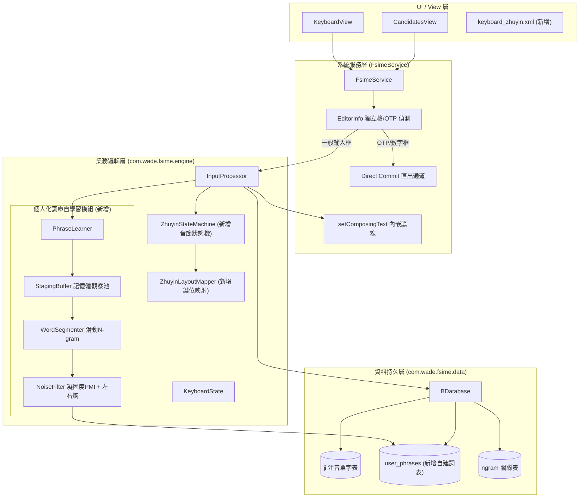
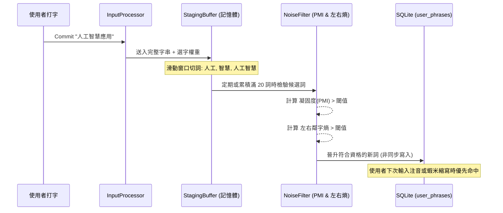

# FSIME (混瞎輸入法) 核心功能升級架構規劃書

本文件針對 FSIME 專案的三大核心演進需求提供完整的架構設計、模組職責劃分、演算法規格及關鍵程式碼骨架，以利後續進行程式碼編修與建置。

---

## 總覽：三大功能目標與架構變更



---

## 功能一：純注音鍵盤（預設倚天注音，支援切換大千標準）

### 1.1 需求分析與挑戰
* **保留混蝦鍵盤**：原本的 `keyboard_fsime.xml` 維持現狀，新增獨立純注音鍵盤。
* **注音種類切換**：
  * **倚天注音（41 鍵，預設）**：聲母、介音、韻母依倚天佈局，聲調使用數字列（`1` ˙、`2` ˊ、`3` ˇ、`4` ˋ，空白為一聲）。
  * **大千 / 標準注音（41 鍵）**：最常見的台灣注音排列（1~0 與 Q~P 等，`phone.cin.txt` 對應鍵位）。
  * **擴充預留**：倚天 26 鍵或許氏注音。
* **狀態機機制**：純注音打字必須支援「聲母 $\rightarrow$ 介音 $\rightarrow$ 韻母 $\rightarrow$ 聲調」的音節組合，遇到聲調鍵時視為音節閉合並觸發候選字確定。

### 1.2 設定選項擴充 (`preferences.xml`)
在 `app/src/main/res/xml/preferences.xml` 的 General 分類加入注音鍵盤排列偏好：
```xml
<ListPreference
    android:key="zhuyin_layout"
    android:title="注音鍵盤排列"
    android:entries="@array/zhuyin_layout_entries"
    android:entryValues="@array/zhuyin_layout_values"
    android:defaultValue="eten41"
    app:useSimpleSummaryProvider="true" />
```

在 `app/src/main/res/values/strings.xml` 定義清單：
```xml
<string-array name="zhuyin_layout_entries">
    <item>倚天注音 (41 鍵 - 預設)</item>
    <item>標準大千注音 (41 鍵)</item>
</string-array>
<string-array name="zhuyin_layout_values">
    <item>eten41</item>
    <item>standard</item>
</string-array>
```

### 1.3 鍵盤版面設計 (`keyboard_zhuyin.xml`)
建立 `app/src/main/res/xml/keyboard_zhuyin.xml`。
依據倚天 41 鍵配置，將實體按鍵的 `valueText` 對應至內部代碼或注音符號。

### 1.4 音節狀態機與鍵位解碼 (`ZhuyinStateMachine.kt`)
新建 `app/src/main/java/com/wade/fsime/engine/zhuyin/` 目錄：
* **`ZhuyinLayoutMapper.kt`**：負責將實體按鍵（依目前設定是 `eten41` 或 `standard`）轉換為標準注音符號（如 `ㄅ`, `ㄆ`, `ㄧ`, `ㄤ`, `ˋ`）。
* **`ZhuyinSyllable.kt`**：
  ```kotlin
  data class ZhuyinSyllable(
      val initial: String? = null, // 聲母 (ㄅ~ㄙ)
      val medial: String? = null,  // 介音 (ㄧ, ㄨ, ㄩ)
      val `final`: String? = null, // 韻母 (ㄚ~ㄦ)
      val tone: String? = null     // 聲調 (空白, ˊ, ˇ, ˋ, ˙)
  ) {
      fun toDisplay(): String = "${initial ?: ""}${medial ?: ""}${final ?: ""}${tone ?: ""}"
      fun isComplete(): Boolean = tone != null || (toDisplay().isNotEmpty() && tone == " ")
  }
  ```
* **與資料庫 `ji` 表的映射**：
  * 現有 `b.db` 的 `ji` 表 `eng` 欄位放的是標準鍵位代碼（例如 `1`=ㄅ, `u`=ㄧ, `4`=ˋ $\rightarrow$ `1u4`=意）。
  * 狀態機將組合出的注音符號統一換算為標準 `ji` 鍵碼（或增加注音字串欄位），直接查詢 `bdatabase.getWord()`。

---

## 功能二：無監督新詞發現與個人化自建詞庫 (Phrase Mining)

### 2.1 核心流程與演算法
為避免使用者日常打字時頻繁寫入 SQLite 導致卡頓，設計**「雙層架構」**：
1. **記憶體觀察池 (Staging Buffer)**：即時收集與計分。
2. **門檻檢驗器 (Noise Filter)**：以凝固度 (PMI) 與自由度 (左右熵) 排除垃圾詞。
3. **SQLite 沉澱 (Persistence)**：符合門檻後非同步晉升。



### 2.2 關鍵過濾演算法規格
1. **凝固度 (Pointwise Mutual Information, PMI)**：
   $$PMI(w_1, w_2) = \log_2 \frac{P(w_1 w_2)}{P(w_1) \times P(w_2)}$$
   * 若 $PMI > 3.0$，表示此二字並非隨機碰撞，有高強度的結構黏性。
2. **左右資訊熵 (Branching Entropy)**：
   $$H(W) = -\sum_{x} P(x|W) \log_2 P(x|W)$$
   * 左右兩邊接續字的熵值必須 $> 1.2$，確保該詞彙能獨立成詞，而不是「的時」、「是在」等斷詞碎片。

### 2.3 資料庫結構擴充 (`BDatabase.kt`)
在 `BDatabase.initializeUserTable()` 中新增自建詞庫表：
```sql
CREATE TABLE IF NOT EXISTS user_phrases (
    phrase TEXT PRIMARY KEY,
    boshiamy_code TEXT,
    zhuyin_code TEXT,
    freq REAL,
    last_used INTEGER
);
CREATE INDEX IF NOT EXISTS idx_phrase_boshiamy ON user_phrases (boshiamy_code);
CREATE INDEX IF NOT EXISTS idx_phrase_zhuyin ON user_phrases (zhuyin_code);
```

### 2.4 自動編碼拼裝 (Auto-Encoding)
當新詞「天氣」晉升入庫時：
* **嘸蝦米編碼**：查單字表得到 `天` $\rightarrow$ `gb`、`氣` $\rightarrow$ `k`，自動合成取首碼詞簡碼 `gk` 與全碼 `gbk`。
* **注音編碼**：查注音表得到 `天` $\rightarrow$ `ㄊㄧㄢ`、`氣` $\rightarrow$ `ㄑㄧˋ`，合成 `ㄊㄧㄢㄑㄧˋ` 與聲母簡碼 `ㄊㄑ`。
* **下次鍵入**：使用者打 `gk` 或注音 `ㄊㄑ`，「天氣」即直接排在首位候選。

### 2.5 詞庫整理與修剪 (Decay & Pruning)
* 在服務關閉或閒置時，執行定期維護：
  ```sql
  -- 時間衰減：所有詞頻衰減 10%
  UPDATE user_phrases SET freq = freq * 0.9;
  -- 淘汰清理：清除頻率低於 1.0 的過期詞
  DELETE FROM user_phrases WHERE freq < 1.0;
  -- 限制自建詞上限 20,000 筆，超出時清理 LRU
  DELETE FROM user_phrases WHERE phrase NOT IN (
      SELECT phrase FROM user_phrases ORDER BY freq DESC LIMIT 20000
  );
  ```

---

## 功能三：輸入流體驗優化（直出模式 + setComposingText）

### 3.1 獨立格子 `[ ] [ ] [ ] [ ]`（OTP 驗證碼框）直出模式
* **問題根源**：目前的按鍵全滯留在 `InputProcessor.state.composingText`，系統輸入框收不到字元，導致獨立格子無法自動跳格。
* **解決方式**：在 `FsimeService` 的按鍵分發前進行智慧判斷：

```kotlin
// 在 FsimeService.kt 中的判斷邏輯
private fun isDirectCommitField(editorInfo: EditorInfo?): Boolean {
    if (editorInfo == null) return false
    val inputType = editorInfo.inputType
    val inputClass = inputType and InputType.TYPE_MASK_CLASS
    val inputVariation = inputType and InputType.TYPE_MASK_VARIATION

    // 1. 數字輸入框 (常作為驗證碼、PIN 碼)
    if (inputClass == InputType.TYPE_CLASS_NUMBER || inputClass == InputType.TYPE_CLASS_PHONE) return true
    // 2. 密碼框
    if (inputVariation == InputType.TYPE_TEXT_VARIATION_PASSWORD ||
        inputVariation == InputType.TYPE_TEXT_VARIATION_VISIBLE_PASSWORD ||
        inputVariation == InputType.TYPE_NUMBER_VARIATION_PASSWORD) return true
    
    return false
}
```
* **按鍵執行**：
  若 `isDirectCommitField(currentInputEditorInfo)` 為真，按鍵時**不呼叫 `inputProcessor.appendStroke()`**，而是直接 `currentInputConnection?.commitText(keyText, 1)`。
  * **效果**：輸入驗證碼時一按立刻進字，系統自動觸發 App 的焦點跳轉，免按 Enter。

### 3.2 一般輸入框：`setComposingText` 內嵌底線組字
在非直出模式（一般文字框）下：
1. **打字中**：呼叫 `ic.setComposingText(composing, 1)`，字元會帶底線出現在游標處，告知 App 當前處於組字階段。
2. **選字/確認時**：呼叫 `ic.commitText(candidate, 1)`，Android 系統會自動抹除該段底線文字並替換為中文字。
3. **退格 (Backspace)**：呼叫 `inputProcessor.backspace()` 後，若剩餘字串不為空，直接再呼叫一次 `ic.setComposingText(newComposing, 1)` 覆蓋；若已退完則呼叫 `ic.commitText("", 1)` 關閉組字區間。

---

## 程式碼骨架與修改清單

### 1. 新增檔案結構
```
app/src/main/
├── java/com/wade/fsime/
│   ├── engine/
│   │   ├── zhuyin/
│   │   │   ├── ZhuyinLayoutMapper.kt       # 倚天/大千鍵位映射
│   │   │   ├── ZhuyinSyllable.kt           # 音節數據模型
│   │   │   └── ZhuyinStateMachine.kt       # 狀態機與音節判定
│   │   └── phrase/
│   │       ├── PhraseLearner.kt            # 詞庫挖掘主調度器
│   │       ├── StagingBuffer.kt            # 記憶體 LRU 觀察池
│   │       ├── WordSegmenter.kt            # 滑動 N-gram 切詞
│   │       └── NoiseFilter.kt              # 凝固度與自由度檢驗
└── res/
    └── xml/
        └── keyboard_zhuyin.xml             # 純注音鍵盤佈局
```

### 2. 核心類別骨架範例

#### `ZhuyinStateMachine.kt`
```kotlin
package com.wade.fsime.engine.zhuyin

class ZhuyinStateMachine(private var layout: String = "eten41") {
    private var currentSyllable = StringBuilder()

    fun setLayout(newLayout: String) {
        layout = newLayout
    }

    /**
     * 輸入一個按鍵符號，回傳是否為完整音節結束（例如遇到聲調）
     */
    fun processKey(keyChar: String): ProcessResult {
        val zhuyinChar = ZhuyinLayoutMapper.map(keyChar, layout) ?: return ProcessResult.Invalid
        currentSyllable.append(zhuyinChar)
        val isTone = ZhuyinLayoutMapper.isTone(zhuyinChar, layout)
        return if (isTone) {
            val syllable = currentSyllable.toString()
            currentSyllable.clear()
            ProcessResult.Completed(syllable)
        } else {
            ProcessResult.Composing(currentSyllable.toString())
        }
    }

    sealed class ProcessResult {
        object Invalid : ProcessResult()
        data class Composing(val text: String) : ProcessResult()
        data class Completed(val fullSyllable: String) : ProcessResult()
    }
}
```

#### `PhraseLearner.kt`
```kotlin
package com.wade.fsime.engine.phrase

import com.wade.fsime.data.BDatabase
import kotlinx.coroutines.*

class PhraseLearner(private val database: BDatabase) {
    private val scope = CoroutineScope(Dispatchers.Default + SupervisorJob())
    private val stagingBuffer = StagingBuffer()
    private val noiseFilter = NoiseFilter()

    fun onTextCommitted(text: String, isSelectedByUser: Boolean) {
        if (text.length < 2) return
        scope.launch {
            // 1. 滑動 N-gram 萃取 2~4 字片段
            val candidates = WordSegmenter.extractCandidates(text)
            // 2. 記錄進暫存池並加權
            stagingBuffer.record(candidates, isSelectedByUser)
            // 3. 檢查是否有詞彙突破門檻
            val readyPhrases = stagingBuffer.getPromotablePhrases { phrase, stat ->
                noiseFilter.evaluate(phrase, stat)
            }
            // 4. 非同步寫入 SQLite
            if (readyPhrases.isNotEmpty()) {
                withContext(Dispatchers.IO) {
                    database.insertUserPhrases(readyPhrases)
                }
            }
        }
    }
}
```

---

## 總結與後續編修建議

1. **開發順序建議**：
   * **第一階段**：實作 `isDirectCommitField` 與 `setComposingText`，優先解決 OTP 驗證碼框跳格與打字即時預覽體驗。
   * **第二階段**：建立 `ZhuyinStateMachine` 與 `keyboard_zhuyin.xml`，實作預設倚天注音輸入。
   * **第三階段**：掛入 `PhraseLearner` 模組，讓輸入法在背景開始無感自動學習詞庫。
2. 本規格書完全符合專案既有的 Kotlin、SoC 分層架構與純工具模組無 UI 依賴之開發規範。
