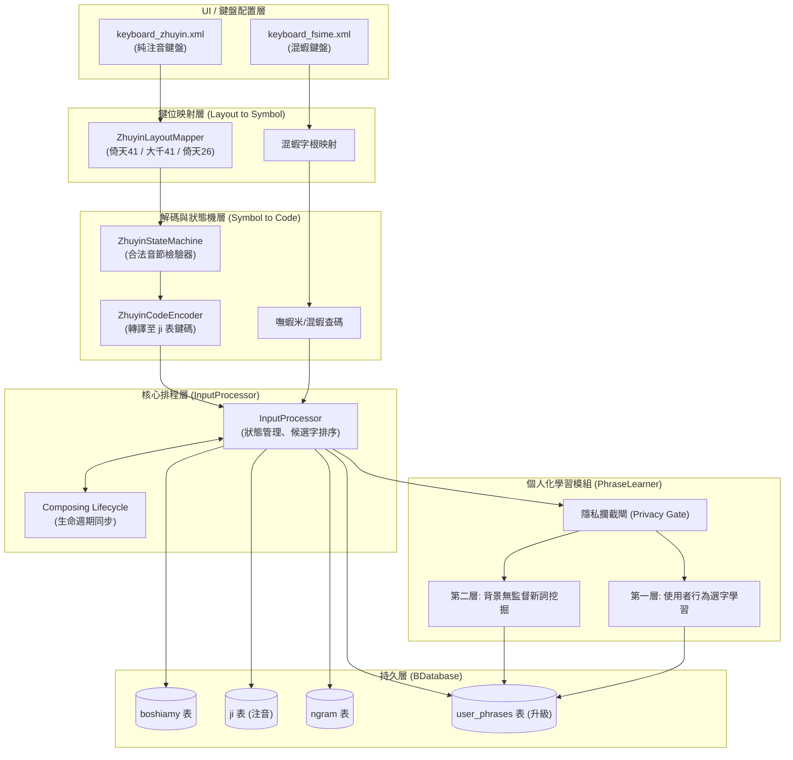
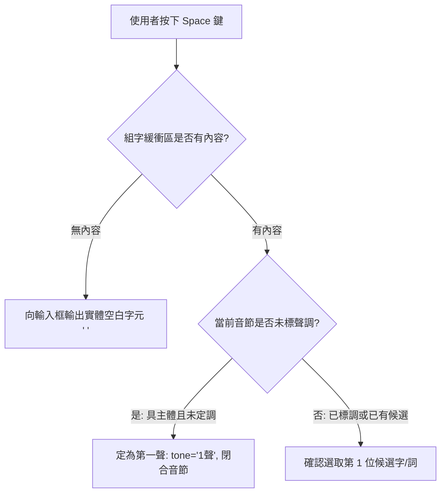
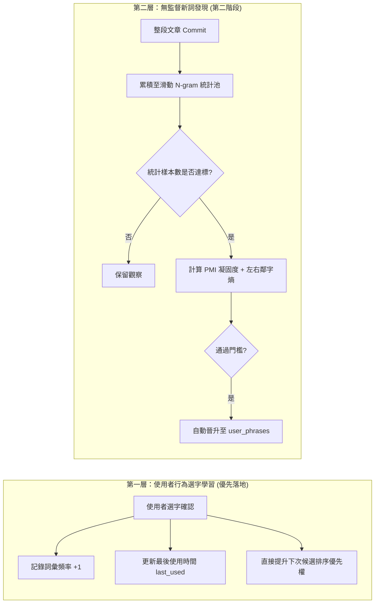
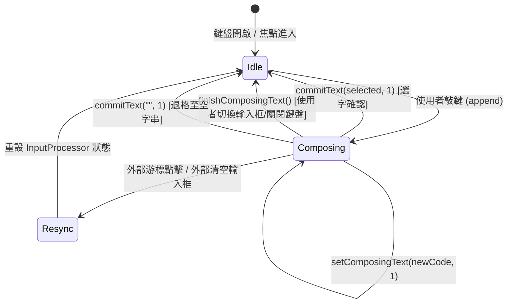

# FSIME (混瞎輸入法) 核心功能升級架構規劃書 (修訂版 v2.0)

> **版本說明**：本版本已完整採納技術審查建議（參考 `ss.md`），針對注音狀態機音節結束條件、空白鍵語意決策、兩層式詞庫學習架構（選字學習 $\rightarrow$ 無監督新詞發現）、PMI/左右熵統計邊界、資料庫多維欄位擴充、OTP 直出邊界判斷、組字生命週期管理、隱私安全防護及執行緒安全進行全面深化與修正。

---

## 目錄
1. [整體架構審查與共用設計](#一整體架構審查與共用設計)
2. [功能一：純注音鍵盤架構與音節狀態機](#二功能一純注音鍵盤架構與音節狀態機)
   - 2.1 鍵位映射與注音解碼分層
   - 2.2 狀態機音節結束條件修正 (非單一聲調依賴)
   - 2.3 空白鍵多義性決策樹
   - 2.4 現有 `b.db` 的 `ji` 表真實編碼規範對齊
3. [功能二：個人化詞庫與漸進式學習架構](#三功能二個人化詞庫與漸進式學習架構)
   - 3.1 兩層學習機制：行為選字學習優先，無監督挖掘在後
   - 3.2 升級版 `user_phrases` 資料庫結構
   - 3.3 嘸蝦米與注音自動編碼規則規範
   - 3.4 隱私安全防護 (Privacy Gate)
   - 3.5 執行緒安全與時間差動態衰減
   - 3.6 雲端詞庫抽象化介面 (`PhraseRepository`)
4. [功能三：輸入流體驗優化與 Android 組字生命週期](#四功能三輸入流體驗優化與-android-組字生命週期)
   - 4.1 OTP / 獨立格子精確判斷與功能鍵保留
   - 4.2 `setComposingText` 完整生命週期管理
5. [重構後的類別階層與程式碼骨架](#五重構後的類別階層與程式碼骨架)
6. [五階段開發里程碑規劃](#六五階段開發里程碑規劃)

---

## 一、整體架構審查與共用設計

為避免維護兩套互不相干的輸入引擎，FSIME 的核心演進原則是：**「混蝦鍵盤與注音鍵盤共用候選詞引擎與資料庫，鍵位配置與語音解碼徹底分離」**。



---

## 二、功能一：純注音鍵盤架構與音節狀態機

### 2.1 鍵位映射與注音解碼分層
依據審查意見，輸入處理必須清晰切分七個層次：
```
Keyboard Layout (鍵盤佈局 XML)
       ↓
Physical Key Mapping (實體按鍵轉換為字符)
       ↓
Zhuyin Symbol (轉換為標準注音符號: ㄅ, ㄆ, ㄧ, ㄚ, ˊ, ˇ...)
       ↓
Syllable Parser (音節語法狀態機: 檢驗結構合法性)
       ↓
Zhuyin Code Encoder (依據 b.db 的 ji 表規範編碼)
       ↓
Existing Database Query (查詢單字與關聯詞)
       ↓
Candidate Ranking (候選字權重排序)
```
這種分層使得未來擴充「倚天 26 鍵」或「許氏注音」時，只需新增映射表，解碼器、狀態機與資料庫查詢完全不需更動。

### 2.2 狀態機音節結束條件修正 (非單一聲調依賴)
原規劃直接以「是否按了聲調鍵」判定音節結束，此邏輯存在重大缺陷：
1. **第一聲無調號**：中文第一聲（陰平）通常不敲調號，例如「灣 (`ㄨㄢ`)」在資料庫中代碼為 `j0`，結尾沒有調號代碼。
2. **零聲母**：音節可以沒有聲母，如「意 (`ㄧˋ`)」，在資料庫中代碼為 `u4`（直接以介母 `ㄧ` 開頭），絕非 `1u4`。
3. **無聲調連續輸入**：使用者可能連打多個音節而不輸入聲調，遇到下一個聲母時，前一個音節應自動閉合。

**修正後的狀態模型**：
```kotlin
data class ZhuyinSyllable(
    val initial: String? = null, // 聲母: ㄅ~ㄙ (可選)
    val medial: String? = null,  // 介音: ㄧ, ㄨ, ㄩ (可選)
    val `final`: String? = null, // 韻母: ㄚ~ㄦ (可選)
    val tone: String? = null,    // 聲調: 空白(一聲), ˊ, ˇ, ˋ, ˙ (可選)
    val isClosed: Boolean = false // 音節是否已定界閉合
) {
    // 檢查目前已輸入的部分是否構成合法音節片段
    fun isValidPartial(): Boolean = initial != null || medial != null || `final` != null
    
    // 是否已具備發音主體 (介音或韻母)
    fun hasNucleus(): Boolean = medial != null || `final` != null
}
```

狀態機轉移規則：
* **EMPTY $\rightarrow$ INITIAL / MEDIAL / FINAL**：支援直接以介音（如 `ㄧ`）或韻母（如 `ㄢ`）開始音節。
* **遇到聲調符號（ˊ ˇ ˋ ˙）**：設定 `tone`，立即觸發 `isClosed = true`。
* **當已具備韻母或介音，再次收到聲母時**：視為新音節開始，自動將前一個音節閉合並派發。

### 2.3 空白鍵多義性決策樹
空白鍵不可直接硬編碼為第一聲，必須根據目前的組字上下文動態裁決：



### 2.4 現有 `b.db` 的 `ji` 表真實編碼規範對齊
經實際驗證 `b.db` 的真實資料，`ji` 資料表採用標準大千 ASCII 編碼：
* `中` $\rightarrow$ `5j/` (ㄓ ㄨ ㄥ, 第一聲無後綴) 或 `5j/4` (ㄓ ㄨ ㄥ ˋ, 四聲)
* `好` $\rightarrow$ `cl3` (ㄏ ㄠ ˇ), `cl4` (ㄏ ㄠ ˋ)
* `灣` $\rightarrow$ `j0` (ㄨ ㄢ, 零聲母，第一聲無後綴)
* `你` $\rightarrow$ `su3` (ㄋ ㄧ ˇ)
* `意` $\rightarrow$ `u4` (ㄧ ˋ, 零聲母，直接以 `u` 開頭)
* `台` $\rightarrow$ `w9` (ㄊ ㄞ, 一聲) 或 `w96` (ㄊ ㄞ ˊ, 二聲)

**編碼對齊要求**：`ZhuyinCodeEncoder` 必須完全將 `ZhuyinSyllable` 精確映射到上述 ASCII 規則，零聲母不得附加任何聲母預設碼，一聲不得附加額外字元。

---

## 三、功能二：個人化詞庫與漸進式學習架構

### 3.1 兩層學習機制：行為選字優先，無監督挖掘在後
原設計企圖直接對單次輸入句子計算 PMI 與左右熵，在統計學上不可行（樣本數過小、冷啟動無效）。因此將個人化詞庫切分為兩層漸進架構：



### 3.2 升級版 `user_phrases` 資料庫結構
為支援來源追蹤、可信度分級與精準淘汰，表結構擴充如下：

```sql
CREATE TABLE IF NOT EXISTS user_phrases (
    phrase TEXT PRIMARY KEY,           -- 詞彙內容
    boshiamy_code TEXT,                -- 嘸蝦米編碼 (如 gk)
    zhuyin_code TEXT,                  -- 注音編碼 (帶音節邊界, 如 "w96 j0")
    freq REAL DEFAULT 1.0,             -- 動態頻率權重
    selected_count INTEGER DEFAULT 1,  -- 使用者主動點選次數
    source TEXT NOT NULL,              -- 來源: 'manual', 'selected', 'mined', 'cloud'
    confidence REAL DEFAULT 1.0,       -- 可信度評分 (0.0 ~ 1.0)
    created_at INTEGER NOT NULL,       -- 建立時間戳記
    last_used INTEGER NOT NULL         -- 最後使用時間戳記
);

CREATE INDEX IF NOT EXISTS idx_phrases_boshiamy ON user_phrases (boshiamy_code, freq DESC);
CREATE INDEX IF NOT EXISTS idx_phrases_zhuyin ON user_phrases (zhuyin_code, freq DESC);
CREATE INDEX IF NOT EXISTS idx_phrases_lru ON user_phrases (last_used ASC);
```

### 3.3 嘸蝦米與注音自動編碼規則規範
* **嘸蝦米多字詞取碼規則**：
  * 不得任意拼接首碼。應重用既有詞庫規則（二字詞：第一字前兩碼＋第二字前兩碼；三字詞：取各字前一碼；四字以上：前三字首碼＋末字首碼）。
  * 若單字有多種拆法，優先採用最簡碼 (shortest code)。
* **注音編碼規範**：
  * 必須儲存**「帶邊界分隔」**的音節序列（例如 `w96 j0` 或 `ㄊㄞˊ ㄨㄢ`），不得拼合成無邊界字串，以避免音節切分歧義。

### 3.4 隱私安全防護 (Privacy Gate)
輸入法擁有最高敏感度，在 `PhraseLearner` 入口必須建立嚴格攔截：
```kotlin
object PrivacyGate {
    fun shouldLearn(editorInfo: EditorInfo?, prefs: KeyboardPreferences): Boolean {
        if (!prefs.isPersonalizedLearningEnabled()) return false
        if (editorInfo == null) return false
        
        // 1. 系統隱私旗標
        if ((editorInfo.imeOptions and EditorInfo.IME_FLAG_NO_PERSONALIZED_LEARNING) != 0) {
            return false
        }
        
        // 2. 密碼欄位防護
        val inputType = editorInfo.inputType
        val variation = inputType and InputType.TYPE_MASK_VARIATION
        if (variation == InputType.TYPE_TEXT_VARIATION_PASSWORD ||
            variation == InputType.TYPE_TEXT_VARIATION_VISIBLE_PASSWORD ||
            variation == InputType.TYPE_TEXT_VARIATION_WEB_PASSWORD ||
            variation == InputType.TYPE_NUMBER_VARIATION_PASSWORD) {
            return false
        }
        
        return true
    }
}
```

### 3.5 執行緒安全與時間差動態衰減
* **執行緒安全**：`StagingBuffer` 改用 Kotlin `Mutex` 或專屬單一協程通道 (`Channel`) 管理，保證多個 Commit 事件並行時統計資料零競爭。
* **時間差半衰期動態衰減**：
  * 廢除「每次閒置粗暴乘以 0.9」的設計（否則手機閒置頻率會破壞詞頻）。
  * 改採**基於時間差的半衰期模型**，在查詢排序或每週維護時計算：
    $$Weight = Freq \times e^{-\lambda \cdot (Now - LastUsed)}$$
  * 讓頻率自然隨著時間推移合理老化，久未使用的冷詞平滑淘汰。

### 3.6 雲端詞庫抽象化介面 (`PhraseRepository`)
架構預留雲端詞庫擴充彈性，以 Repository Pattern 統一介面：
```kotlin
interface PhraseRepository {
    suspend fun search(code: String, type: CodeType): List<CandidatePhrase>
    suspend fun recordUsage(phrase: String)
}

class CompositePhraseRepository(
    private val localDb: LocalPhraseRepository,
    private val userDb: UserPhraseRepository,
    private val cloudApi: CloudPhraseRepository? = null
) : PhraseRepository {
    override suspend fun search(code: String, type: CodeType): List<CandidatePhrase> {
        // 優先權: 使用者自建詞 > 本機既有詞庫 > 雲端補充 (若啟用)
        val userResults = userDb.search(code, type)
        val localResults = localDb.search(code, type)
        return (userResults + localResults).distinctBy { it.phrase }
    }
}
```

---

## 四、功能三：輸入流體驗優化與 Android 組字生命週期

### 4.1 OTP / 獨立格子精確判斷與功能鍵保留
為避免誤判一般短文字欄位而損害中文輸入，區分兩種層級：

```kotlin
object InputFieldClassifier {
    enum class DirectMode { DIRECT_COMMIT, COMPOSING }

    fun classify(editorInfo: EditorInfo?): DirectMode {
        if (editorInfo == null) return DirectMode.COMPOSING
        val inputType = editorInfo.inputType
        val inputClass = inputType and InputType.TYPE_MASK_CLASS
        val variation = inputType and InputType.TYPE_MASK_VARIATION

        // 確定直出條件
        if (inputClass == InputType.TYPE_CLASS_NUMBER || 
            inputClass == InputType.TYPE_CLASS_PHONE ||
            variation == InputType.TYPE_NUMBER_VARIATION_PASSWORD) {
            return DirectMode.DIRECT_COMMIT
        }
        return DirectMode.COMPOSING
    }
}
```
* **控制鍵語意保留**：在 `DIRECT_COMMIT` 模式下，只有數字符號等輸入鍵直出，**Backspace、Enter、方向鍵等功能鍵仍維持原生 KeyEvent 行為**。

### 4.2 `setComposingText` 完整生命週期管理
組字必須完整涵蓋各種邊界條件（焦點切換、關閉鍵盤、游標不同步）：



在 `FsimeService` 中實作邊界防護：
```kotlin
override fun onFinishInputView(finishingInput: Boolean) {
    super.onFinishInputView(finishingInput)
    // 鍵盤關閉時強制結束未完成的組字，避免殘留底線文字
    currentInputConnection?.finishComposingText()
    inputProcessor.clearComposition()
}

override fun onUpdateSelection(
    oldSelStart: Int, oldSelEnd: Int,
    newSelStart: Int, newSelEnd: Int,
    candidatesStart: Int, candidatesEnd: Int
) {
    super.onUpdateSelection(oldSelStart, oldSelEnd, newSelStart, newSelEnd, candidatesStart, candidatesEnd)
    // 偵測使用者是否主動手動點擊游標離開組字區，若脫鉤則重置組字狀態
    if (candidatesStart != -1 && (newSelStart < candidatesStart || newSelEnd > candidatesEnd)) {
        inputProcessor.clearComposition()
    }
}
```

---

## 五、重構後的類別階層與程式碼骨架

### 5.1 目錄架構
```
app/src/main/java/com/wade/fsime/
├── engine/
│   ├── InputProcessor.kt             # 核心狀態機調度 (瘦身為協調器)
│   ├── KeyboardState.kt              # 不可變 UI 狀態模型
│   ├── zhuyin/                       # [新增] 注音純邏輯模組
│   │   ├── ZhuyinLayoutMapper.kt     # 鍵位佈局映射器
│   │   ├── ZhuyinSyllable.kt         # 音節模型與合法性檢查
│   │   ├── ZhuyinStateMachine.kt     # 狀態機與音節閉合判斷
│   │   └── ZhuyinCodeEncoder.kt      # 對齊 b.db ji 表 ASCII 編碼
│   └── phrase/                       # [新增] 詞庫自學習模組
│       ├── PrivacyGate.kt            # 隱私保護攔截器
│       ├── StagingBuffer.kt          # 執行緒安全之記憶體統計池 (Mutex)
│       ├── WordSegmenter.kt          # 滑動 N-gram 候選詞切分
│       ├── NoiseFilter.kt            # PMI 凝固度與左右鄰字熵過濾器
│       └── PhraseLearner.kt          # 學習管線總協調者
└── data/
    ├── BDatabase.kt                  # 擴充 user_phrases 查詢與維護
    └── repository/                   # [新增] 詞庫抽象層
        ├── PhraseRepository.kt
        ├── LocalPhraseRepository.kt
        └── UserPhraseRepository.kt
```

### 5.2 核心程式碼骨架

#### `ZhuyinStateMachine.kt` (修正版)
```kotlin
package com.wade.fsime.engine.zhuyin

class ZhuyinStateMachine(private var layout: String = "eten41") {
    private var currentSyllable = ZhuyinSyllable()

    fun setLayout(newLayout: String) {
        this.layout = newLayout
        reset()
    }

    fun reset() {
        currentSyllable = ZhuyinSyllable()
    }

    fun currentDisplay(): String {
        return "${currentSyllable.initial ?: ""}${currentSyllable.medial ?: ""}${currentSyllable.`final` ?: ""}${currentSyllable.tone ?: ""}"
    }

    /**
     * 處理單一按鍵輸入
     */
    fun processKey(keyChar: String): ZhuyinStepResult {
        val symbol = ZhuyinLayoutMapper.mapToSymbol(keyChar, layout) ?: return ZhuyinStepResult.Ignored
        
        // 1. 判斷符號類別
        when {
            ZhuyinLayoutMapper.isToneSymbol(symbol) -> {
                currentSyllable = currentSyllable.copy(tone = symbol, isClosed = true)
                val finished = currentSyllable
                reset()
                return ZhuyinStepResult.SyllableClosed(finished)
            }
            ZhuyinLayoutMapper.isInitial(symbol) -> {
                // 若當前已有核心韻母，又收到聲母 -> 前一音節自動閉合 (第一聲)，開始新音節
                if (currentSyllable.hasNucleus()) {
                    val previous = currentSyllable.copy(tone = " ", isClosed = true)
                    currentSyllable = ZhuyinSyllable(initial = symbol)
                    return ZhuyinStepResult.AutoSegmented(previous, currentSyllable)
                } else {
                    currentSyllable = currentSyllable.copy(initial = symbol)
                    return ZhuyinStepResult.Updated(currentDisplay())
                }
            }
            ZhuyinLayoutMapper.isMedial(symbol) -> {
                currentSyllable = currentSyllable.copy(medial = symbol)
                return ZhuyinStepResult.Updated(currentDisplay())
            }
            ZhuyinLayoutMapper.isFinal(symbol) -> {
                currentSyllable = currentSyllable.copy(`final` = symbol)
                return ZhuyinStepResult.Updated(currentDisplay())
            }
        }
        return ZhuyinStepResult.Updated(currentDisplay())
    }

    sealed class ZhuyinStepResult {
        object Ignored : ZhuyinStepResult()
        data class Updated(val displayText: String) : ZhuyinStepResult()
        data class SyllableClosed(val syllable: ZhuyinSyllable) : ZhuyinStepResult()
        data class AutoSegmented(val completed: ZhuyinSyllable, val newSyllable: ZhuyinSyllable) : ZhuyinStepResult()
    }
}
```

#### `PhraseLearner.kt` (具備隱私與線程安全)
```kotlin
package com.wade.fsime.engine.phrase

import android.view.inputmethod.EditorInfo
import com.wade.fsime.data.BDatabase
import com.wade.fsime.engine.KeyboardPreferences
import kotlinx.coroutines.*
import kotlinx.coroutines.sync.Mutex
import kotlinx.coroutines.sync.withLock

class PhraseLearner(
    private val database: BDatabase,
    private val prefs: KeyboardPreferences
) {
    private val scope = CoroutineScope(Dispatchers.Default + SupervisorJob())
    private val mutex = Mutex()
    private val stagingBuffer = StagingBuffer()
    private val noiseFilter = NoiseFilter()

    /**
     * 第一層：使用者主動選字確認 (立即加權學習)
     */
    fun onCandidateSelected(phrase: String, editorInfo: EditorInfo?) {
        if (!PrivacyGate.shouldLearn(editorInfo, prefs)) return
        if (phrase.length < 2) return

        scope.launch {
            withContext(Dispatchers.IO) {
                database.incrementUserPhraseUsage(
                    phrase = phrase,
                    source = "selected",
                    timestamp = System.currentTimeMillis()
                )
            }
        }
    }

    /**
     * 第二層：整段文字送出 (無監督 N-gram 累積觀察)
     */
    fun onSentenceCommitted(sentence: String, editorInfo: EditorInfo?) {
        if (!PrivacyGate.shouldLearn(editorInfo, prefs)) return
        if (sentence.length < 2) return

        scope.launch {
            val ngrams = WordSegmenter.extractNGrams(sentence, minLen = 2, maxLen = 4)
            mutex.withLock {
                stagingBuffer.recordAll(ngrams)
                // 檢查是否有樣本數充足且通過 PMI / 左右熵的候選詞
                val qualified = stagingBuffer.evaluateQualified(noiseFilter)
                if (qualified.isNotEmpty()) {
                    withContext(Dispatchers.IO) {
                        database.batchInsertMinedPhrases(qualified)
                    }
                }
            }
        }
    }
}
```

---

## 六、五階段開發里程碑規劃

為求穩健推進，開發依賴順序調整為五大階段：

| 階段 | 重點任務 | 驗收標準 |
| :--- | :--- | :--- |
| **第一階段：輸入流體驗優化** | 1. 實作 `InputFieldClassifier` (OTP 確定直出)<br/>2. 導入 `setComposingText` 內嵌底線<br/>3. 健全 `onFinishInputView` 與游標同步生命週期 | 獨立驗證碼框一按直出跳格；一般輸入框游標處即時帶底線顯示字根，選字自動乾淨替換。 |
| **第二階段：純注音輸入實作** | 1. 建立 `ZhuyinStateMachine` (支援零聲母、第一聲無調號)<br/>2. 實作 `ZhuyinCodeEncoder` 精確對齊 `ji` 表 ASCII 碼<br/>3. 空白鍵四重語意決策<br/>4. 新增 `keyboard_zhuyin.xml` (預設倚天 41 鍵) | 能在純注音與混蝦之間自由切換；注音音節輸入順暢，單字與片語查詢準確。 |
| **第三階段：第一層個人化選字學習** | 1. 擴充 SQLite `user_phrases` 資料表<br/>2. 掛接 `PrivacyGate` 隱私攔截閘<br/>3. 實作選字即時頻率遞增與時間戳記<br/>4. 查詢時優先合併 `user_phrases` 候選排序 | 使用者選取過的詞彙，下次只要打字首或縮寫即優先置頂；密碼框完全不留痕跡。 |
| **第四階段：第二層無監督新詞挖掘** | 1. 實作滑動 N-gram 觀察池 (`StagingBuffer`)<br/>2. 導入 PMI 凝固度與左右鄰字熵過濾演算法<br/>3. 達成信心度門檻自動晉升入庫<br/>4. 基於時間差之半衰期衰減與清理 | 連續多次鍵入專業術語後，系統在無預置詞庫下自動學會該詞組，且不會學到「的時」等無效斷片。 |
| **第五階段：詞庫抽象層與雲端預留** | 1. 重構為 `PhraseRepository` 介面架構<br/>2. 提供自訂詞庫批次匯入/匯出維護介面<br/>3. 預留雲端詞庫 API 擴充插槽 | 詞庫架構模組化，本機離線查詢毫秒級回應，具備隨時對接外部詞庫之擴展性。 |
